<h1 align="center">Pocket Watch</h1>

  <b>Time tracking, a Pomodoro timer and writing stats for Obsidian, in a fine watch that sits over your notes.</b> 
  Focus sessions · Time tracking · Writing stats · Projects · Desktop and mobile

  
  
  
  

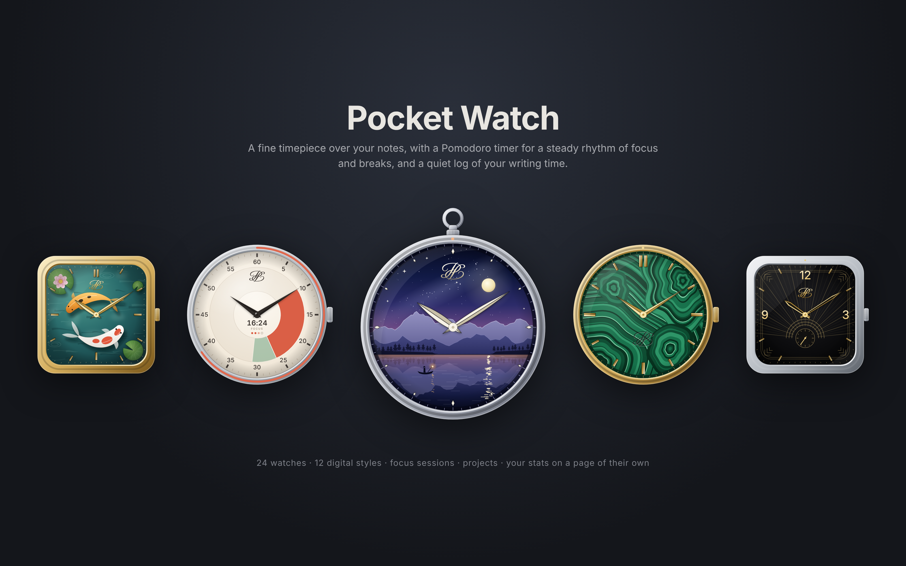

## At a glance

- ⏱️ **Time tracking** that just runs: your time in Obsidian, per day, per note and per project, pausing by itself when you're idle.
- 🍅 **Pomodoro timer** built into the watch: focus sessions, short and long breaks, a soft chime, and a face that paints your session on the dial.
- 📊 **A full stats page** you arrange yourself: a year of days at a glance, trends, your goal, the hours you work, words written, records, and where your time went.
- 🗂️ **Projects** in their own colours, so you can see what your time went toward, and move it if it landed on the wrong one.
- 📅 **Your plan's sections**: link a project to a [Simple Gantt](https://github.com/Nexziz/simple-gantt) timeline and see the hours on each phase and task, in Pocket Watch and on the Gantt chart.
- 📄 **A PDF report** of a project, in its colour, packed with what you'd want to know about the work: to print, or to attach to your thesis.
- ⌚ **27 analog watches and 13 digital ones**, from porcelain and malachite to a tourbillon, a painted lavender field, a spinning vinyl record and a word clock.
- 📱 **Desktop, phone and tablet**, with each device's time kept apart and added up, so sync never overwrites it.

## The watches

Every watch has its own dial, hands, complications and case: a moon phase, small seconds, today's time or a goal dial. Drag one onto a corner of a pane and it snaps into place. Drop it on a tab bar and it tucks in there, in a bolder mini version that stays readable when it's small. If you'd rather it stayed out of the way, let it fade back when you leave it alone; it comes back when you point at it, and when time is up.

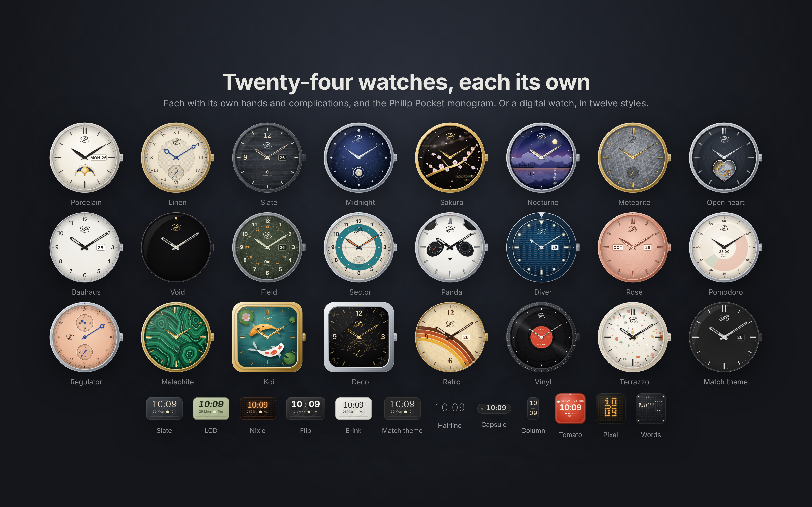

<table>
  <tr>
    <td>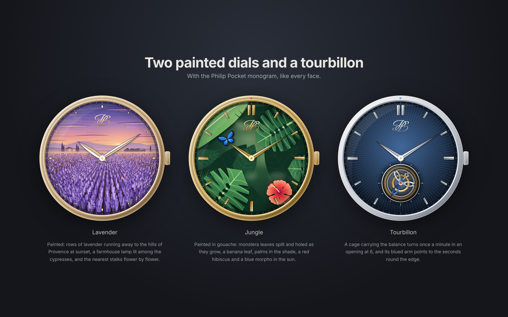</td>
    <td>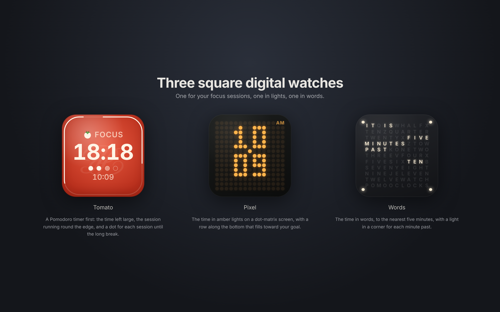</td>
  </tr>
  <tr>
    <td>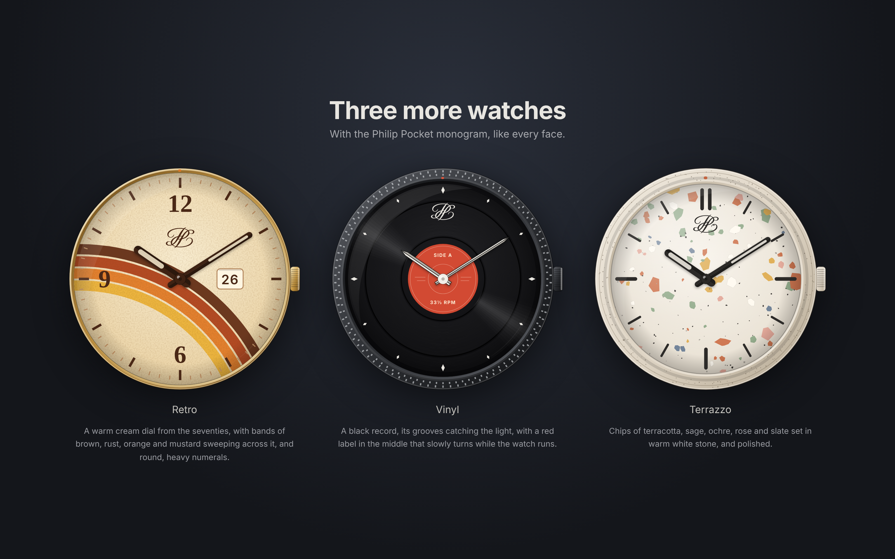</td>
    <td>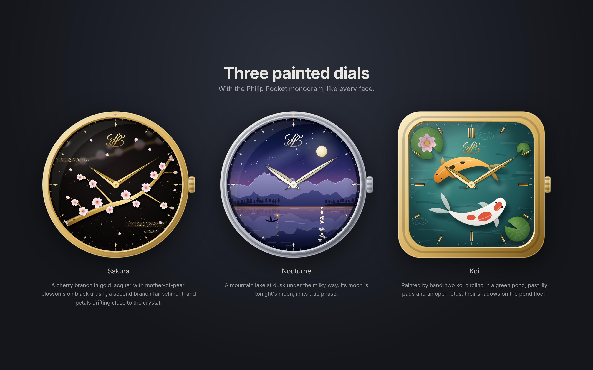</td>
  </tr>
</table>

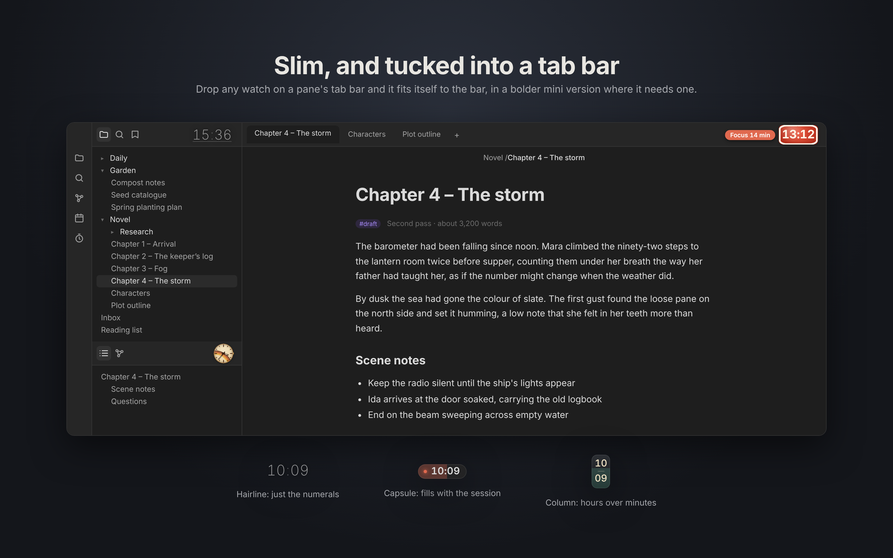

## Pomodoro and focus

- Start a session from the watch, the shelf or the command palette. The bezel counts down, a chime marks the end, and the break can start on its own, with a long break every few sessions.
- The **Pomodoro** face and the **Tomato** watch show how much focus is left and when the break comes, with a dot for each session until the long break.
- When time is up, the watch glows, takes on a colour or shows a small dot until you respond.
- In colour, orange is focus and green is a break. In greyscale the watch stays quiet while you focus.

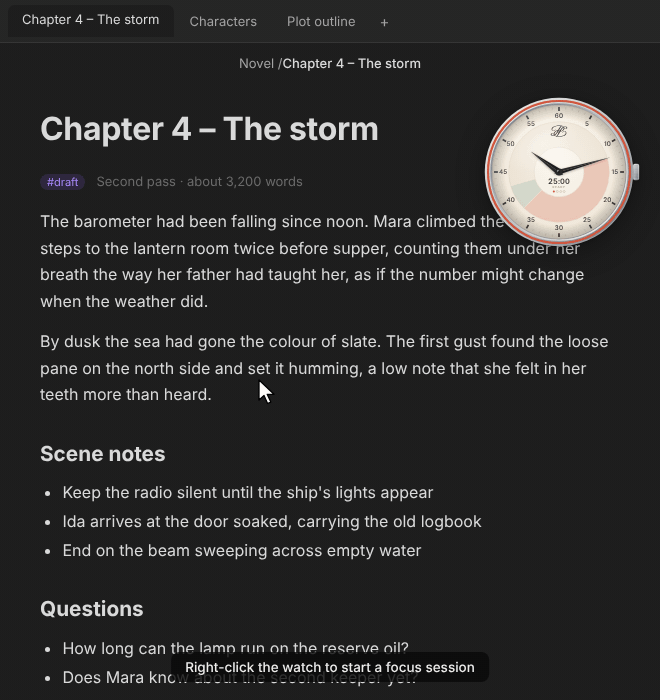

<table>
  <tr>
    <td>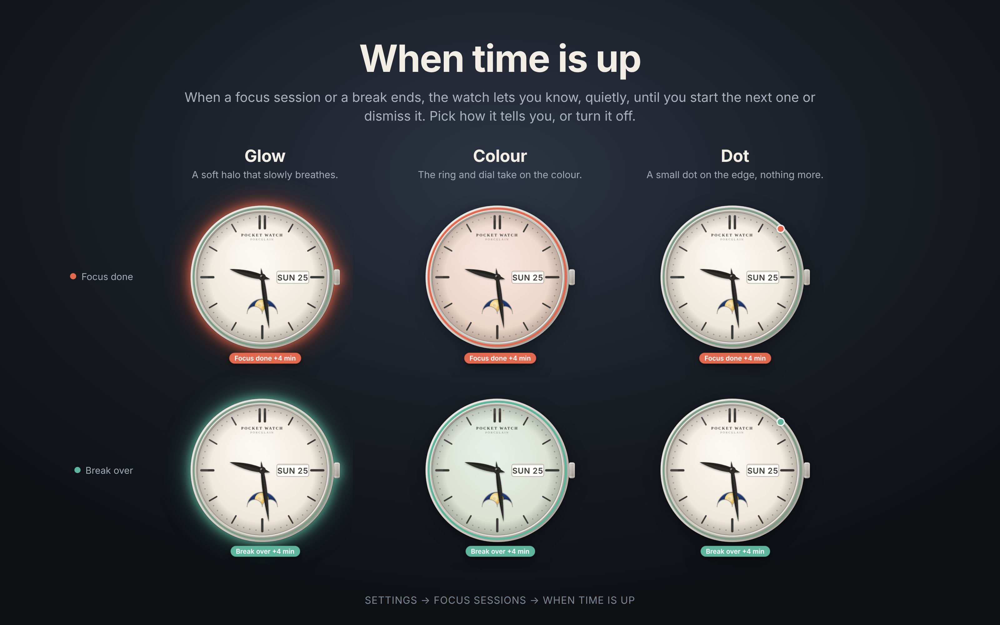</td>
    <td>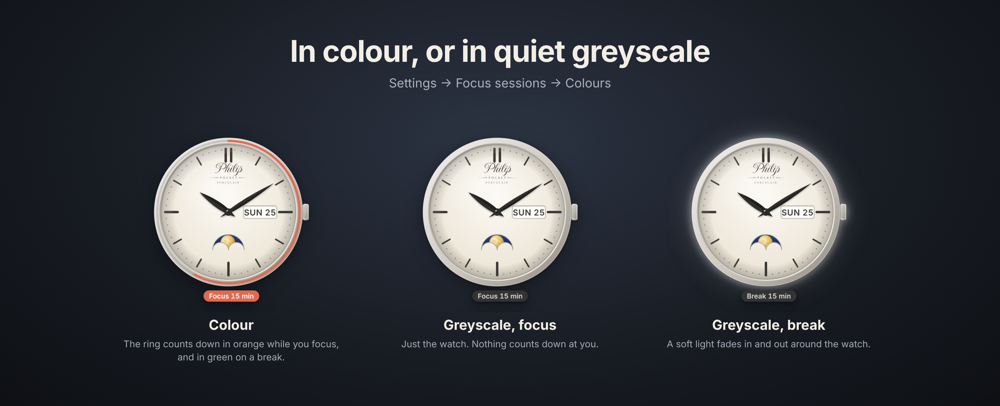</td>
  </tr>
</table>

## Time tracking and stats

- **Click the watch** for today, your focus sessions and a calendar of your time.
- **Open the stats page** for the past year, the last 7, 30 or 90 days or all time: time against the period before, your daily goal, the hours you work on a 24-hour dial, your week, your writing, the notes and folders your time went to, and your records.
- **Idle limit**: the timer stops after a while with no typing, clicking or scrolling. Reading counts.
- **Track outside Obsidian** with one click, while you research in a browser or a PDF reader.
- **Projects** each have a colour. Switch from the shelf or the command palette, lock the one you're on, show one or several on the stats page, and move time between projects with an undo.
- **Arrange the page**: press *Edit layout*, then drag the cards where you want them, make them wide or narrow, and hide the ones you don't need. Bring them back whenever you like.
- **How you work**: as you write, Pocket Watch also counts the keys you type, Backspace, pastes and undos, the time you spend typing rather than reading and thinking, the words you write in each hour and each note, your fastest minute, each sitting and when it starts, the notes you open and make, the links you add and the tasks you tick off, and the breaks you take.

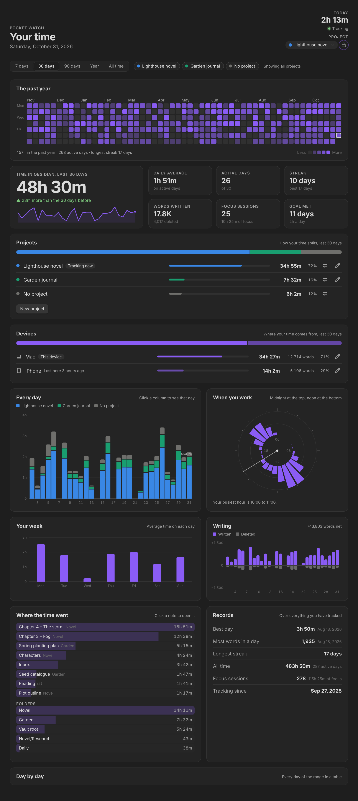

## Your plan, phase by phase

Plan the work on a timeline with [Simple Gantt](https://github.com/Nexziz/simple-gantt), then edit a project here and choose that timeline. Its phases and tasks become the project's sections, and your time on the project is shared out among them, day by day:

1. **The note you're in.** Time in a note that a task links to goes to that task. That includes the time you'd already spent in it, so linking a note later brings its earlier hours along.
2. **What you're working on.** Pick a phase or task from **Working on** on the shelf, the stats page, the watch's menu or the command palette. It stays until you change it, on that device.
3. **The plan.** Otherwise, when the timeline plans one task for that day (or several, all in one phase), the time goes there.

Whatever's left is **not sorted**. Press **Sort…** to choose where each day's time goes, with an undo. The **Sections** card on the stats page shows each phase and task in its colour, with its hours, its days and when it was planned. In Simple Gantt the hours show after each task's name, under each phase, in the overview panel and on paper.

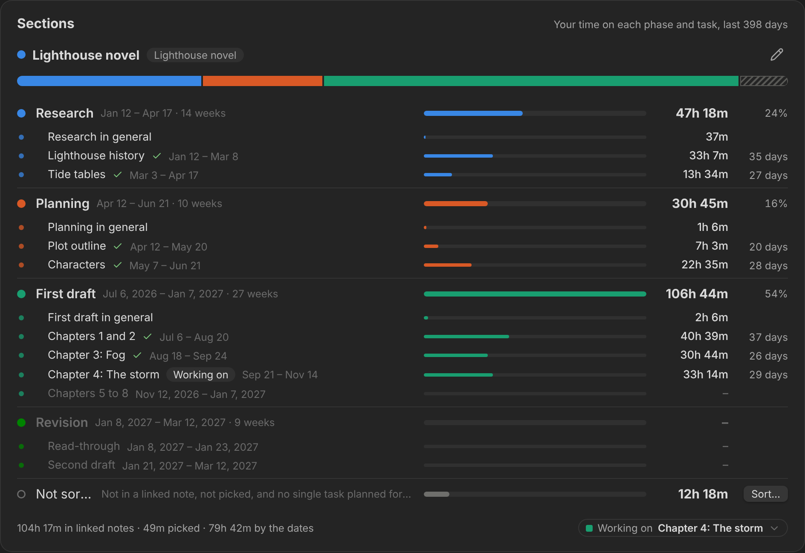

Don't want them somewhere? In Simple Gantt, switch **Hours worked** off under the timeline's Features, or only for paper in Print / PDF. In the report, set **The timeline** to off. On the stats page, hide the Sections card with **Edit layout**.

## A report of the work

When a project is done, press **PDF report** on the stats page (or run *Make a PDF report of your time*) for pages that sum it up, ready to print or to attach to a dissertation or thesis.

- **Pick what it covers**: one project, several, or all your time. Several get pages of their own, each in its project's colour, or share pages with each project in its colour.
- **Pick what it shows, section by section.** Start from *Essentials*, *Balanced* or *Everything*, then set each section to off, essentials, balanced or everything:
  - the big numbers, the timeline (each phase and task as planned, with the days you actually worked on it and its hours), every day of the work, time each week, and words adding up
  - your working day (when it started and ended), when you worked, your week, and the time of day you work best
  - how you write: words an hour, what you kept, keys and Backspace, your fastest minute, time typing
  - the text itself, read from your notes: the words in them, your favourite word, the longest, sentence length, reading time, citations, footnotes, links and questions
  - sittings, focus sessions and the devices you worked on
  - where the time went, folders and chapters, milestones and month by month
  - records, fun facts and highlights
- **Pick the dates**, a title and a line for your name, A4 or US Letter, portrait or landscape, and whether it fits on one page or takes as many as it needs.
- **Save it as a PDF, or as images.** It's saved in your vault, where attachments go, and opens in Obsidian.

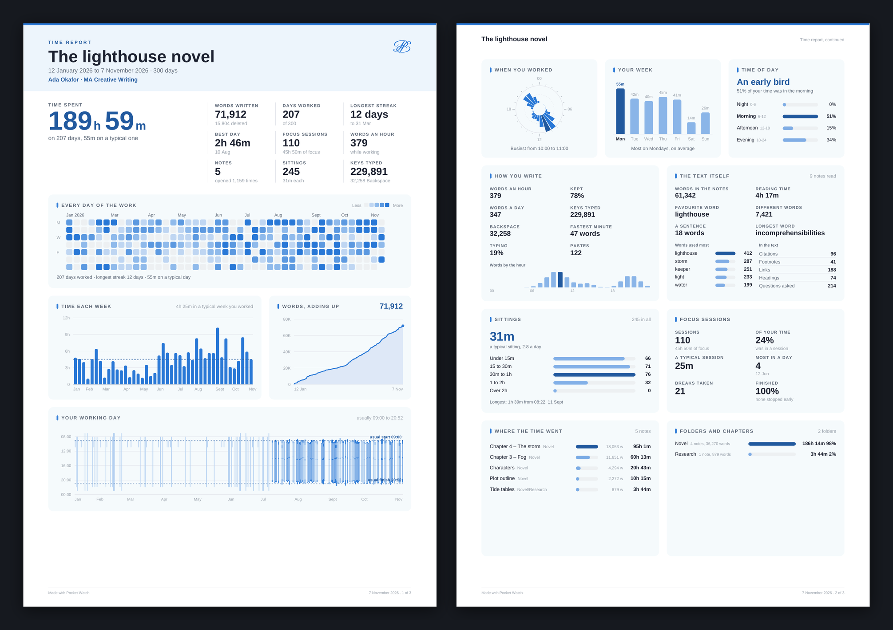

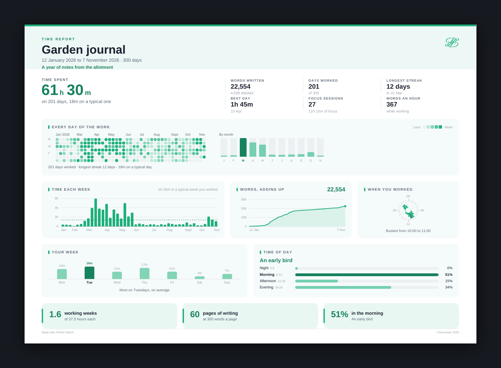

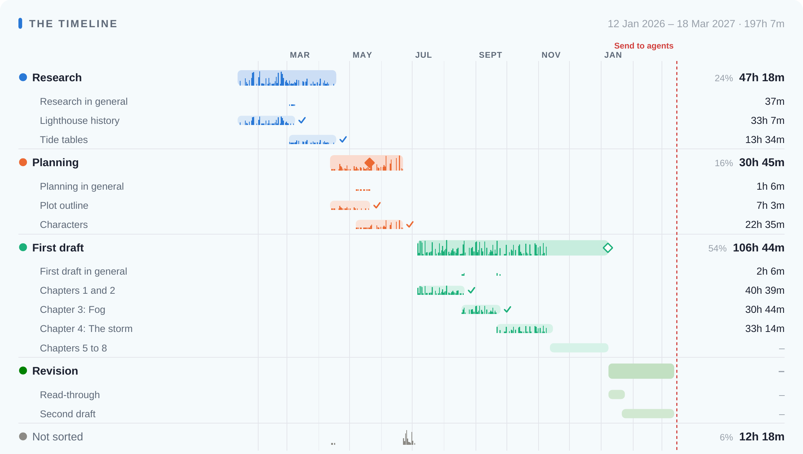

## On every device

Pocket Watch runs on desktop, phones and tablets. On a phone it counts while Obsidian is on screen, and the watch sits in the bar at the top of the note, between its buttons, out of the way of your writing. Tap it for your stats, and press and hold it for the menu.

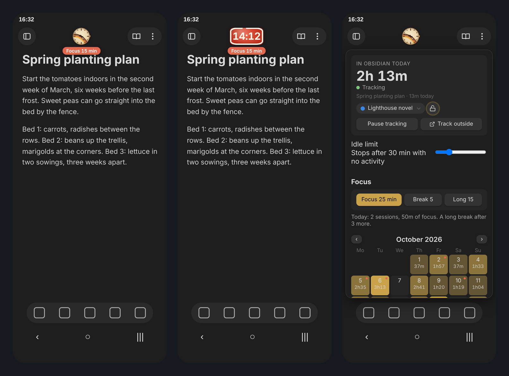

With your vault synced, each device keeps its own record of your time, so your computer and phone never overwrite each other, and the stats page adds them all up. The **Devices** card shows where your time comes from, with the words written on each, and you can rename a device or change its kind.

## Install

Search for **Pocket Watch** in Settings → Community plugins once it's listed. Until then, download `manifest.json`, `main.js` and `styles.css` from the [latest release](https://github.com/Nexziz/pocket-watch/releases/latest) into `.obsidian/plugins/pocket-watch/` in your vault, and enable **Pocket Watch** in Settings → Community plugins.

If you use it on more than one device, update every device to 1.14 or later.

<b>Settings</b>

- **Watch**: every watch in a gallery to pick from, its size, its position, and whether it fades back when left alone.
- **Customise**: the case, monogram, hour markers, hands, seconds hand, complications, goal ring and movement, or for a digital watch its layout, clock and what it shows.
- **Focus sessions**: lengths, long breaks, starting automatically, colour or greyscale, how time being up shows, and the chime.
- **Tracking**: daily goal, idle limit, and your data.
- **Devices**: rename your devices, or take in or forget an old one.

## Privacy

Pocket Watch works entirely offline. It makes no network requests and only writes its own `data.json` in the plugin folder, and the PDF reports you ask it to save. Words written are counted from how a note's word count changes as you edit it. Chinese, Japanese and Korean characters count as one word each, as in Obsidian's own count.

## Support

Pocket Watch is made by one person in their spare time. If it brings you a little joy, a coffee keeps new watches coming. There's also a button at the top of the plugin's settings.

  

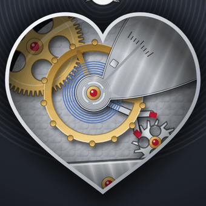

## Credits and license

The Philip Pocket monogram is drawn from Great Vibes, under the [SIL Open Font License](https://openfontlicense.org). Pocket Watch is under the [MIT](LICENSE) license.
