# Pocket Watch

A fine timepiece that sits over your notes, with a Pomodoro timer for a steady rhythm of focus and breaks, and a quiet log of your writing time.

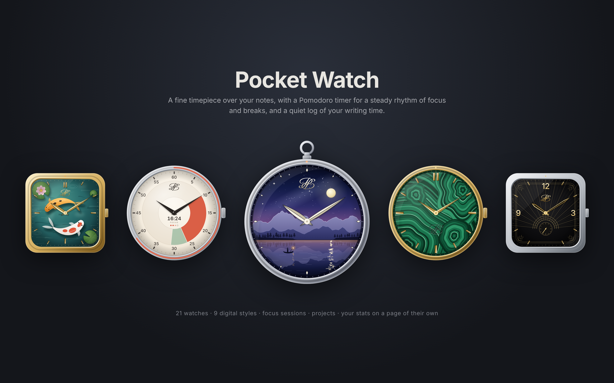

## A timepiece

- **Twenty-one watches, each its own.** Every face carries the Philip Pocket monogram, the interlaced PP (engraved into Malachite and Meteorite), and comes with its own hands and complications: a date, small seconds, your words today or a goal dial. Two have a moon phase, each in its own window: Porcelain's classic arch with gold moons, and Midnight's round window onto a realistic moon, with its age in days around it. Regulator gives the minutes the centre and turns the hours on a small dial of their own, Malachite is cut from polished green stone, Panda has a panda's face, and Open heart shows its movement through a heart-shaped window. You can also pick your own.
- **Two square watches**: Koi, painted by hand, with two koi circling in a green pond past lily pads and a lotus, and Deco, black lacquer in stepped gold lines whose small seconds is a rising sun.
- **Slim digital watches** that show just the time: Hairline, bare numerals in your theme's colours that fade back until you point at them; Capsule, a slim pill that fills up with your session; and Column, the hours over the minutes in a narrow strip.
- **Two painted dials**: Sakura, a cherry branch in gold lacquer with mother-of-pearl blossoms on black, and Nocturne, a mountain lake at dusk whose moon is tonight's moon.
- **Snaps where you put it.** Drag it over a pane and it snaps to a corner or edge. Drop it on a pane's tab bar and it tucks in there, sized to fit the bar, analog or digital. Drop it on the ribbon or status bar to snap it to the window, or hold Alt to place it anywhere.
- **Any size**: drag the handle on the watch, or hold Alt and scroll over it.
- **Click it** for your calendar and stats. Right-click it to start a focus session.

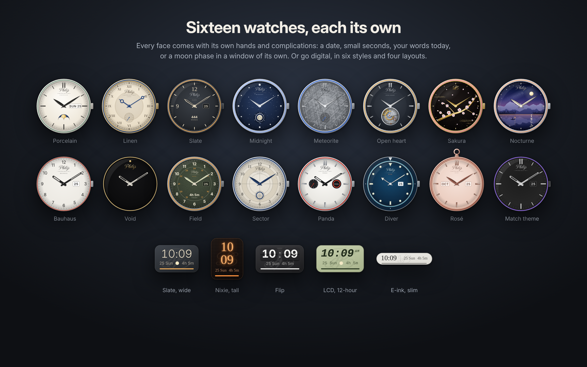

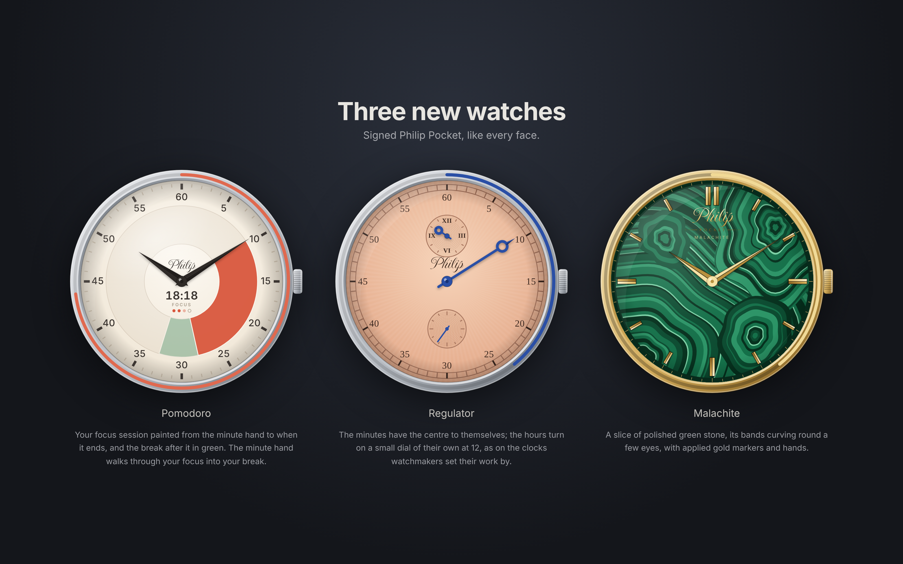

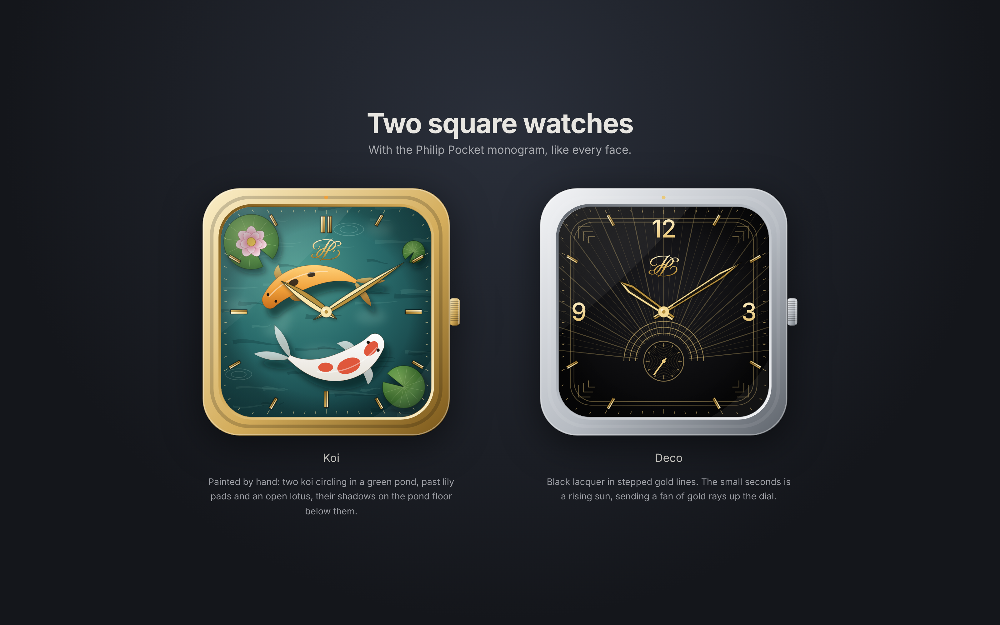

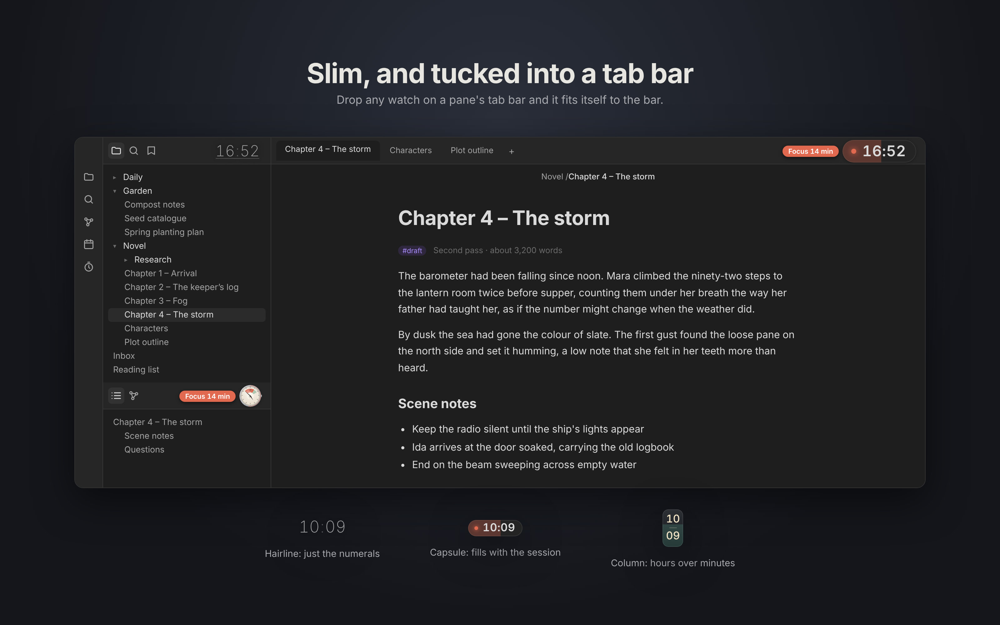

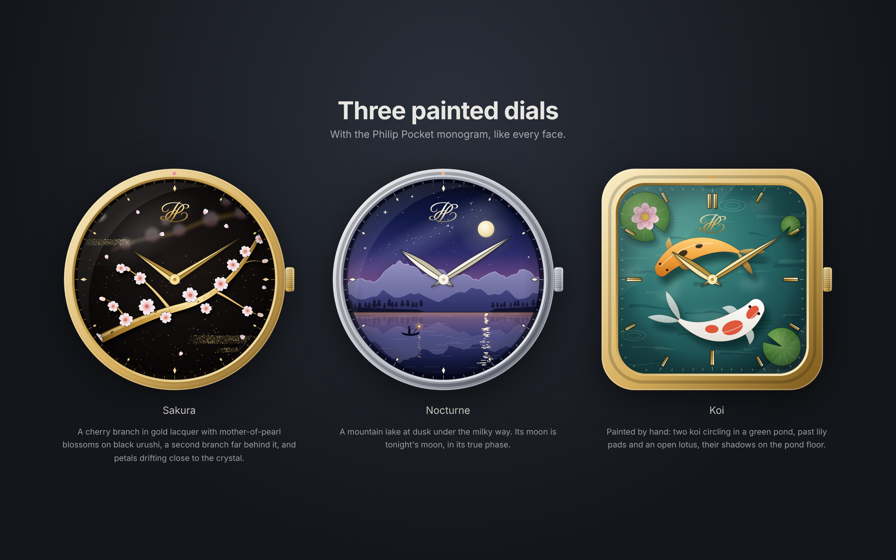

## Focus and breaks

- **Pomodoro, built in.** Start from the watch, the shelf or the command palette. The bezel counts down, a soft chime marks the end, and your break can begin on its own, with a long break every few sessions.
- **The Pomodoro face** paints your focus session on the dial, from the minute hand to when it ends, and the break after it in a second colour, so you can see at a glance how much focus is left and when the break comes. In the middle: the time left, and a dot for each session until the long break.
- **When time is up**, the watch tells you until you respond, with a glow, a wash of colour or a small dot. The label next to it counts the minutes past, and the menu offers the next step.
- **In colour or in greyscale.** In colour, orange is focus and green is a break. In greyscale, the watch is just a watch while you focus, and a soft light fades around it on a break.

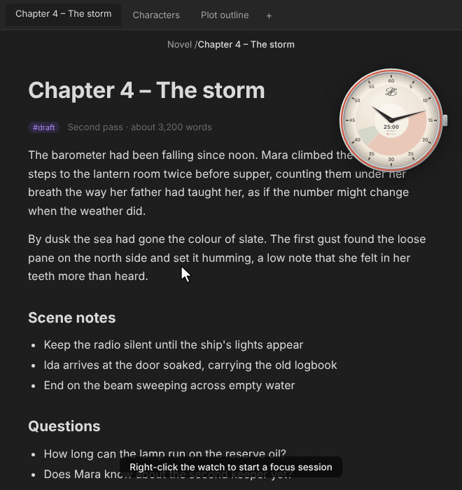

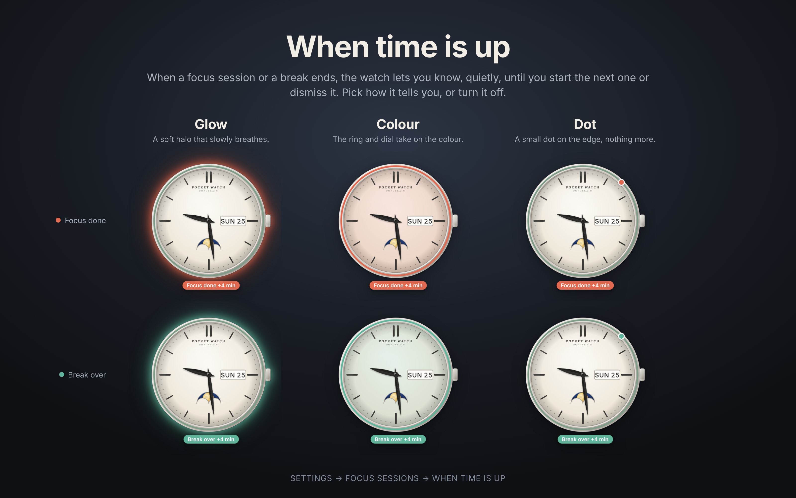

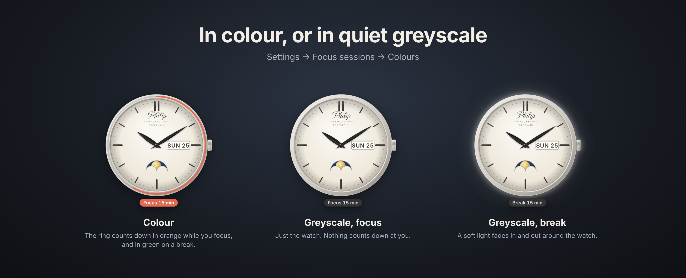

## Your time

- **Idle limit**: the timer stops after 30 minutes (or what you choose) with no typing, clicking, scrolling or mouse movement. Reading and scrolling count.
- **Track outside Obsidian**: one click on the shelf (or the watch's menu, or the command palette) keeps counting while you read or research in another app. The idle limit waits until you're back, and it stays on until you turn it off or restart Obsidian.
- **Calendar**: click the watch for today, focus sessions and a calendar of your time, with where each day's time went. Click a note to open it.
- **Your stats, on a page of their own**: the past year as a square for every day, then for the last 7, 30 or 90 days, the year or all time: your time against the period before, every day against your goal, the hours you work on a 24-hour dial, your week, your writing, the notes and folders your time went to, your records, and a table of every day. Open it from the shelf, the watch's menu or the command palette.
- **Time in each note**: the note you're in gets the time too. Renamed notes and folders keep their time.
- **Projects**: track your time toward a project, like your proposal now and your dissertation after the deadline. Each has its own colour. Change the project from the shelf, the stats page or the command palette, and lock it so a stray click can't switch it. On the stats page, turn projects on and off to see one, several or all of them: the page takes a project's colour when it shows just one, and stacks them by colour when it shows several.
- **Status bar**: today's time and the minutes left in a session.

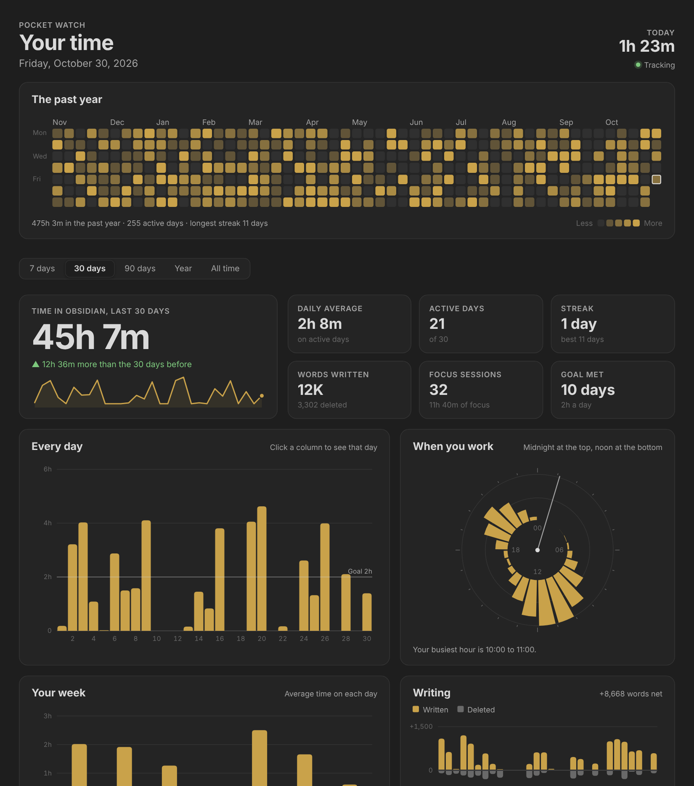

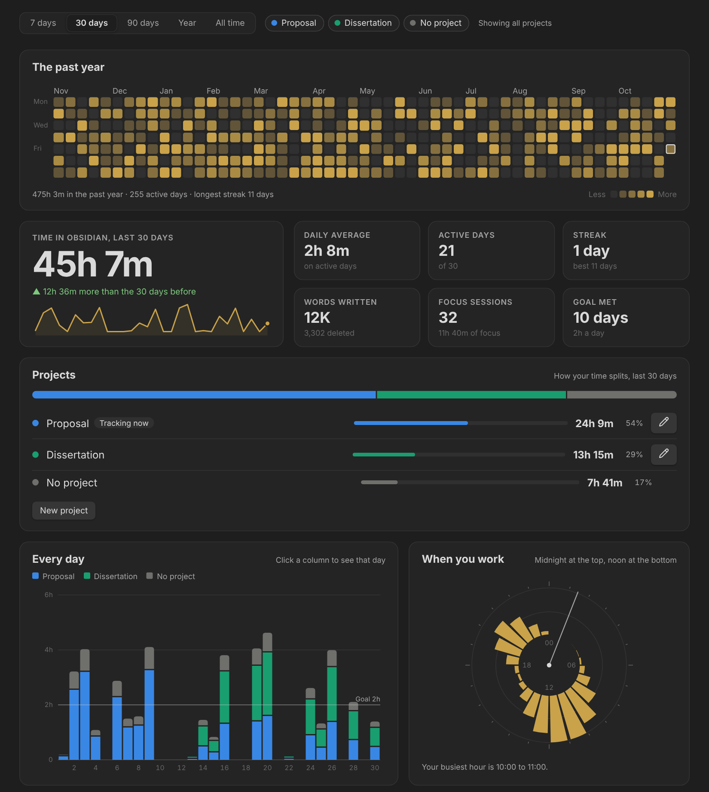

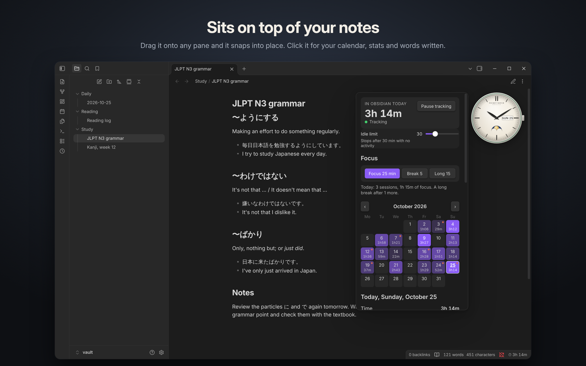

## Install

Search for **Pocket Watch** in Settings → Community plugins once it's listed. Until then, download `manifest.json`, `main.js` and `styles.css` from the [latest release](https://github.com/Nexziz/pocket-watch/releases/latest) into `.obsidian/plugins/pocket-watch/` in your vault, then enable **Pocket Watch** in Settings → Community plugins.

## Settings

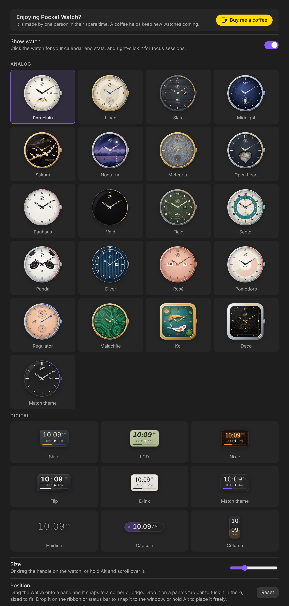

- **Watch**: every watch in a gallery to pick from, its size, and its position.
- **Customise**: for the watch you picked, its case, monogram, hour markers, hands, seconds hand, complications (as designed or your own), goal ring and movement, or for the digital watch its layout, clock and what it shows.
- **Focus sessions**: lengths, long breaks, starting automatically, the countdown label, colour or greyscale, how time being up shows, and the chime.
- **Tracking**: daily goal, idle limit, and more.

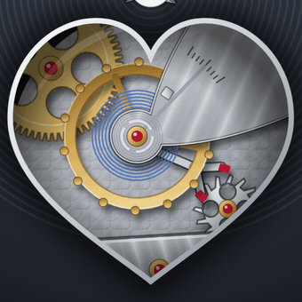

## Words and privacy

Words written and deleted come from how a note's word count changes while you edit it. Chinese, Japanese and Korean characters count as one word each, as in Obsidian's own count.

Pocket Watch works entirely offline. It makes no network requests and only writes its own `data.json` in the plugin folder.

## Support

Pocket Watch is made by one person in their spare time. If it brings you a little joy, you can buy me a coffee, from the button at the top of the plugin's settings or here:

## Credits and license

The Philip Pocket monogram is drawn from Great Vibes, under the [SIL Open Font License](https://openfontlicense.org). The plugin is under the [MIT](LICENSE) license.
