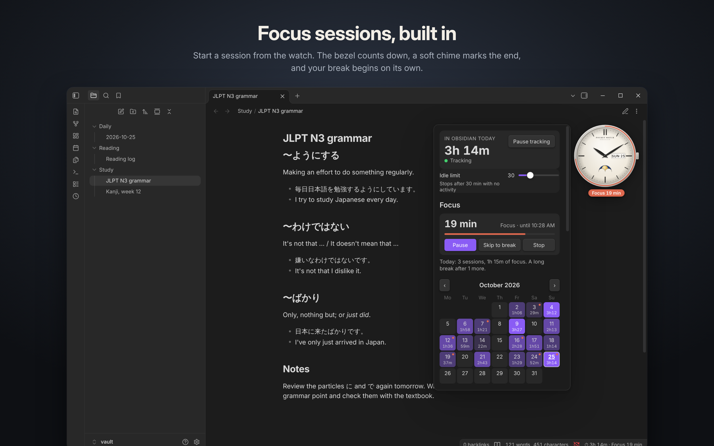
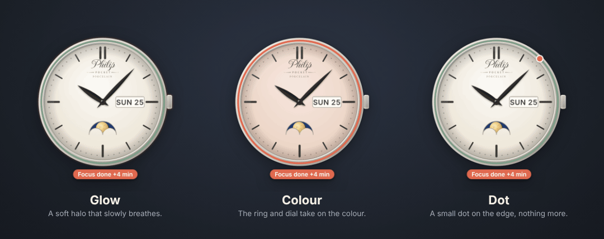

# Pocket Watch

A calm little timepiece that sits on top of your notes, and quietly keeps track of the time you spend in them.

## The watch

- **Shows the time of day**, with hands that move by the minute. Add a ticking or sweeping seconds hand if you like.
- **Snaps where you put it.** Drag it over a pane and it snaps to the nearest corner or edge, then stays there when you resize or rearrange things. Drop it on the ribbon or status bar to snap it to the edge of the window, or hold Alt to place it anywhere.
- **Any size.** Drag the handle that appears when you point at the watch, hold Alt and scroll over it, or use the slider in the settings.
- **Click it** to open a shelf with your calendar and stats. Right-click it for focus sessions and other quick actions.

## Focus sessions

- **Pomodoro, built in.** Start a focus session from the shelf, the command palette, or by right-clicking the watch.
- **The bezel counts down**, in a warm colour while you focus and in green during a break, and a small label next to the watch shows the minutes left.
- **When time is up**, a soft chime plays and the watch lets you know until you respond: orange after focus, green after a break. Choose how it shows: a **glow** that slowly breathes, a wash of **colour** over the ring and dial, or a small **dot** on the edge. The label next to the watch counts the minutes past ("Focus done +3 min"), and right-clicking the watch or opening the shelf offers the next step: a break, another session, or dismiss.
- **Breaks can start on their own**, with a long break after every few sessions. When they do, the highlight shows for a minute and then steps aside.
- **Every session counts**: the shelf shows today's sessions and focus time, the calendar marks the days you focused, and the stats add them up.
- Choose the length of focus sessions and short and long breaks, how many sessions come before a long break, and whether breaks and the next session start automatically.

## Make it yours

- **Twelve faces**, each with its own finish: Porcelain (glossy enamel), Linen (a guilloché centre and Roman numerals), Slate (brushed, with raised numerals), Midnight (aventurine on a sunburst), Open heart (with a window onto a ticking movement), Bauhaus, Void, Field (a matte grained dial), Sector, Diver (a wave dial with luminous markers in metal surrounds), Rosé (faceted rose gold markers), and one that matches your theme.
- **Watchmaking details**: a stepped bezel, faceted hands, polished applied markers, a minute track on the flange, a domed cap, reflections on the crystal, and the name printed on the dial (you can turn it off).
- **Case**: a crown, a pocket watch bow, or plain.
- **Hour markers**: the face's own, or batons, numerals, Roman numerals, dots, diver markers, a single dot, or none.
- **Hands**: Leaf, Baton, Breguet, Dauphine, Sword, Pencil or Arrow.
- **At 12, 3, 6 and 9 o'clock**, choose what you'd like to see: the date, the weekday and date, the month, a moon phase window, a movement window, your time in Obsidian today, today's words, your streak, a goal dial, small seconds, or nothing at all.
- **Daily goal**: a ring on the bezel fills up as you work, and dims while the timer is paused.
- **Digital**: six styles (Slate, LCD, Nixie, Flip, E-ink, Match theme) in four layouts (Wide, Slim, Tall, Compact), in 12 or 24 hours, with optional seconds, a blinking colon, the date, the moon, today's time and a goal bar.

The open heart face shows a movement through a window in the dial: the balance wheel with its timing screws and blued Breguet hairspring swinging five times a second under a polished cock with its regulator, the pallet fork and escape wheel ticking with it, a wheel of the gear train turning once a minute, Geneva stripes, perlage, rubies and blued screws. You can slow it to a gentle swing or stop it in the settings.

## Time tracking

- **Idle limit**: the timer stops after a set time with no typing, clicking, scrolling or mouse movement (30 minutes by default). Any activity starts it again. Reading and scrolling count as activity.
- **Calendar**: each day shows the time you spent. Click a day to see its time and word stats compared with today.
- **Stats**: last 7 and 30 days, all time, daily average, streak, best day, words written and deleted, and a 14-day chart.
- **Status bar and commands**: today's time also shows in the status bar, along with the minutes left in a focus session. The clock icon in the ribbon opens the shelf, and there are commands to open the shelf, show or hide the watch, switch between analog and digital, pause the timer, and start, pause or stop a focus session, and dismiss the time's-up highlight.

## Install

Search for **Pocket Watch** in Settings → Community plugins once it's listed. Until then:

1. In your vault, open the folder `.obsidian/plugins/` (create `plugins` if it's missing).
2. Make a folder called `pocket-watch` in it, and download `manifest.json`, `main.js` and `styles.css` from the [latest release](https://github.com/Nexziz/pocket-watch/releases/latest) into it.
3. In Obsidian, open Settings → Community plugins, turn off Restricted mode if it's on, and enable **Pocket Watch**.

## Settings

- **Watch**: show or hide it, analog or digital, and its size.
- **Analog**: face, case, name on the dial, hour markers, hands, seconds hand, what shows at 12, 3, 6 and 9 o'clock, the goal ring, and how the movement moves (lifelike, gentle or still).
- **Digital**: style, layout, 12 or 24 hours, seconds, blinking colon, date, moon phase, today's time and the goal bar.
- **Focus sessions**: focus, short break and long break lengths, how many sessions before a long break, starting breaks and the next session automatically, the countdown label, how the watch shows that time is up (glow, colour, dot or off, with a preview), and the chime.
- **Placement**: reset the watch to the bottom right corner of the note you're working in.
- **Tracking**: daily goal, idle limit, removing idle time, only counting while Obsidian is focused, the first day of the week, and resetting your data.

## How words are counted

Words written and words deleted come from how a note's word count changes while you edit it. Chinese, Japanese and Korean characters count as one word each, the same way Obsidian's own word count does it. Changes that arrive while you aren't typing or clicking (for example from sync) are not counted.

## Privacy

Pocket Watch works entirely offline. It makes no network requests, collects no telemetry, and only reads and writes its own `data.json` inside your vault (`.obsidian/plugins/pocket-watch/data.json`). It doesn't read or change your notes, apart from counting words in the note you're editing.

## License

[MIT](LICENSE)
