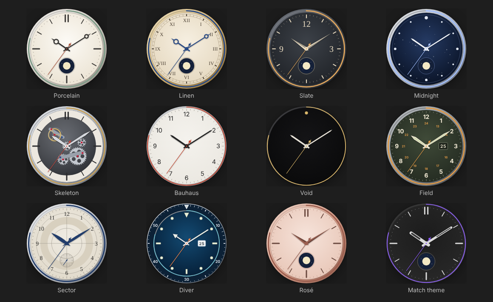
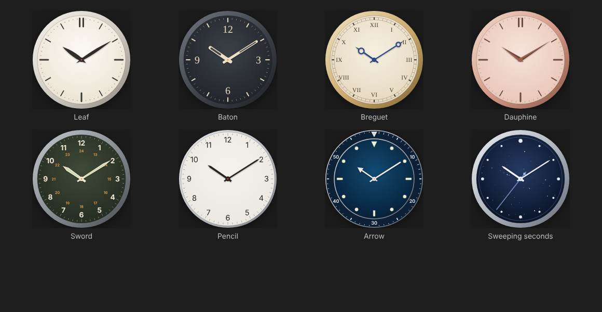
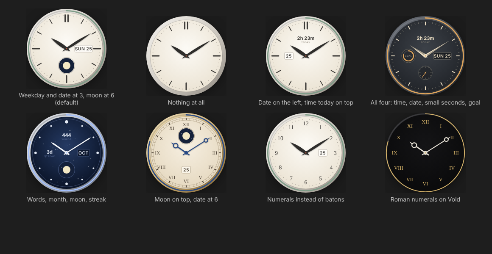
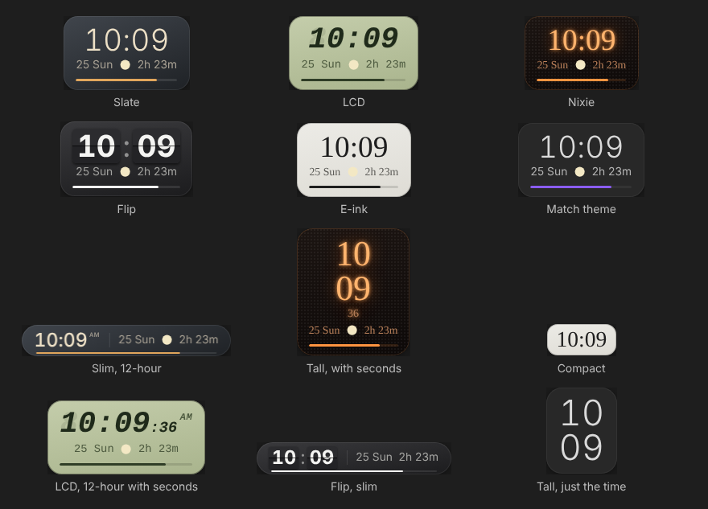
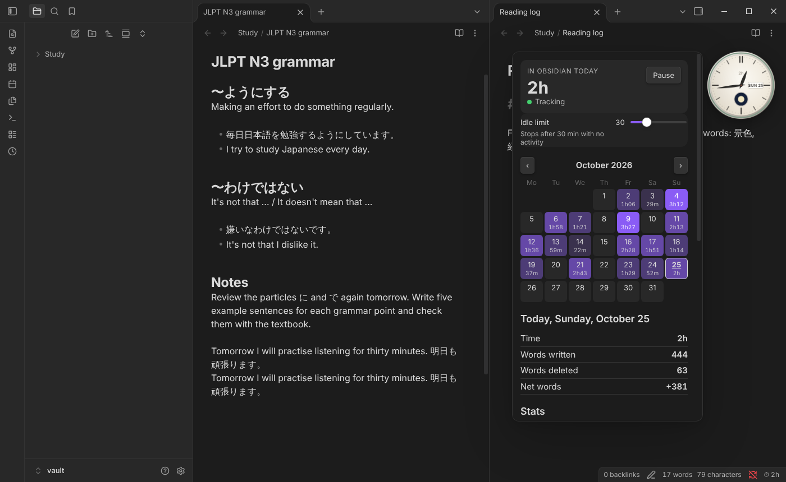
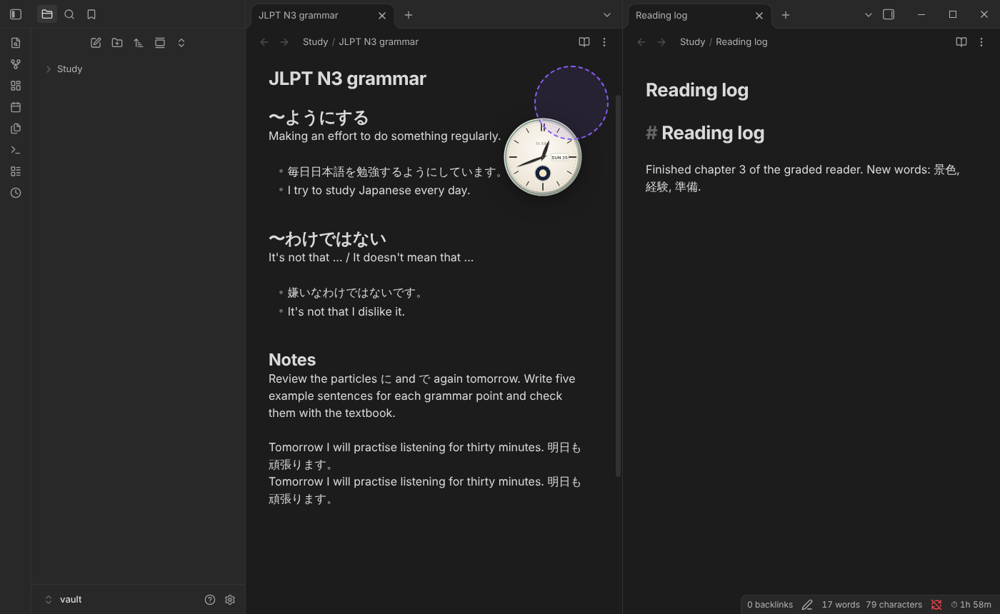

# Pocket Watch

A calm little timepiece that sits on top of your notes and keeps track of how long you spend in Obsidian.

- **A small timepiece over your notes** that shows the time of day. Click it to open a shelf with your calendar and stats.
- **Snaps where you put it**: drag it over a pane and it snaps to the nearest corner or edge, then stays there when you resize or rearrange things. Drop it on the ribbon or status bar to snap it to the edge of the window, or hold Alt to place it anywhere.
- **Any size**: drag the handle that appears when you point at the watch, hold Alt and scroll over it, or use the slider in the settings.
- **Twelve analog faces**: Porcelain, Linen, Slate, Midnight, Skeleton (with a turning movement), Bauhaus, Void, Field, Sector, Diver, Rosé, and one that matches your theme.
- **Hour markers and hands**: keep the face's own markers or pick batons, numerals, Roman numerals, dots, diver markers, a single dot or none. Seven hand styles: Leaf, Baton, Breguet, Dauphine, Sword, Pencil and Arrow. Seconds hand off, ticking or sweeping.
- **Your choice at 12, 3, 6 and 9 o'clock**: the date, weekday and date, month, moon phase, today's time, today's words, your streak, a goal dial, a small seconds dial, or nothing.
- **Digital, too**: six styles (Slate, LCD, Nixie, Flip, E-ink, Match theme) and four layouts (Wide, Slim, Tall, Compact), in 12 or 24 hours, with optional seconds, a blinking colon, the date, the moon, today's time and a goal bar.
- **Daily goal**: a ring on the bezel (or a bar on the digital watch) fills up as you work, and dims while the timer is paused.
- **Idle limit**: the timer stops after a set time with no typing, clicking, scrolling or mouse movement (30 minutes by default). Any activity starts it again. Reading and scrolling count as activity.
- **Calendar**: each day shows the time you spent. Click a day to see its time and word stats compared with today.
- **Stats**: last 7 and 30 days, all time, daily average, streak, best day, words written and deleted, and a 14-day bar chart.
- Today's time also shows in the status bar. The clock icon in the ribbon opens the shelf, and there are commands to open the shelf, show or hide the watch, switch between analog and digital, and pause the timer.

## Install

1. In your vault, open the folder `.obsidian/plugins/` (create `plugins` if it's missing).
2. Make a folder called `pocket-watch` in it and copy `manifest.json`, `main.js` and `styles.css` there.
3. In Obsidian, open Settings → Community plugins, turn off Restricted mode if it's on, and enable **Pocket Watch**.

Your data is stored in `.obsidian/plugins/pocket-watch/data.json`.

## Privacy

Pocket Watch works entirely offline. It makes no network requests, collects no telemetry, and only reads and writes its own `data.json` inside your vault. It doesn't read or change your notes, apart from counting words in the note you're editing.

## Settings

- **Watch**: show or hide it, analog or digital, and its size.
- **Analog**: face, hour markers, hands, seconds hand, what shows at 12, 3, 6 and 9 o'clock, the goal ring, and gentle motion for the skeleton face.
- **Digital**: style, layout, 12 or 24 hours, seconds, blinking colon, date, moon phase, today's time and the goal bar.
- **Reset watch position**: snap the watch back to the bottom right corner of the note you are working in.
- **Daily goal**: how many minutes fill the ring.
- **Idle limit**: minutes without activity before the timer stops (1 to 120).
- **Remove idle time**: when the timer goes idle, take back the minutes that passed without activity.
- **Only count while Obsidian is focused**: pause while another app is in front (on by default).
- **Week starts on Monday**
- **Reset all data**

## How words are counted

Words written and words deleted come from how a note's word count changes while you edit it. Chinese, Japanese and Korean characters count as one word each, the same way Obsidian's own word count does it. Changes that arrive while you aren't typing or clicking (for example from sync) are not counted.
